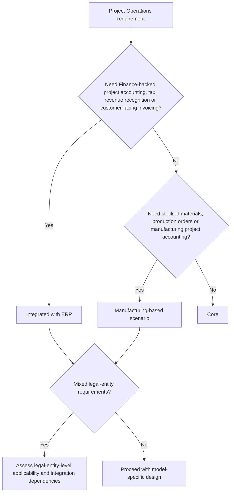

# Deployment Models

Microsoft documents multiple Project Operations deployment options. The choice is not cosmetic: it changes system ownership, accounting depth, integration, operating model and remediation paths.

## Decision overview

:::info[Official deployment guidance]

Microsoft's deployment-type guidance lists Project Operations Core, Project Operations Integrated with ERP and Project Operations for manufacturing as deployment options, and notes that stocked/production order and non-stocked/resource-based scenarios can be supported on the same environment through legal-entity-level configuration. See [Determine your deployment type](https://learn.microsoft.com/en-us/dynamics365/project-operations/environment/determine-deployment-type).

:::

## Working comparison

| Model | Use when | Key consultant concerns |
| --- | --- | --- |
| Core | Dataverse-focused project sales, planning, resourcing, time, basic expense, material usage, project budgeting, forecasting, subcontracting and proforma invoicing are sufficient. | Confirm Finance is not expected to own accounting, tax, customer invoice posting or revenue recognition. |
| Integrated with ERP | The implementation needs Finance-backed accounting, tax, exchange rates, financial dimensions, customer-facing invoicing or revenue recognition. | Confirm dual-write prerequisites, map versions, project accounting ownership, reconciliation and Finance legal-entity setup. |
| Manufacturing-based scenarios | Stocked materials, production orders, inventory-backed project work or manufacturing project accounting are material. | Confirm legal-entity applicability, modern architecture options and the boundary between production, inventory and project accounting. |
| Mixed scenario | Different legal entities need different capabilities in one environment. | Validate legal-entity-level configuration and avoid assuming one operating model applies everywhere. |

:::warning[Migration is not a simple switch]

Microsoft notes that out-of-box data migration between deployment types is not supported and that moving data can require custom scripts, concept mapping and manual intervention. Treat deployment model selection as an architectural decision, not a minor configuration choice.

:::

## Assessment questions

- Which deployment model is currently installed or proposed?
- Which legal entities use which project operating model?
- Is Finance present, and if so, which project accounting responsibilities sit there?
- Are dual-write maps installed and current?
- Are project invoices customer-facing from Finance or only proforma from Dataverse?
- Is manufacturing, stocked inventory or production-order integration in scope?

## Primary Microsoft documentation

- [Determine your deployment type](https://learn.microsoft.com/en-us/dynamics365/project-operations/environment/determine-deployment-type)
- [Deploy Project Operations Core](https://learn.microsoft.com/en-us/dynamics365/project-operations/environment/lite-deployment)
- [Project Operations Integrated with ERP deployment overview](https://learn.microsoft.com/en-us/dynamics365/project-operations/environment/project-operations-integrated-deployment-overview)
- [Project Operations updates](https://learn.microsoft.com/en-us/dynamics365/project-operations/whats-new/project-operations-updates)
