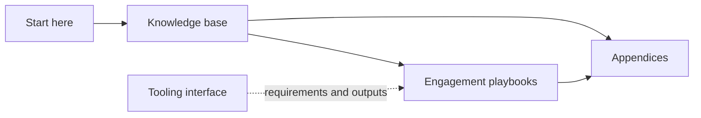

# Start Here

This area separates stable product knowledge from engagement-specific delivery logic and reusable artefacts.



## Content boundaries

| Area | Purpose | Do not use it for |
| --- | --- | --- |
| Knowledge base | Reusable facts, concepts, architecture, processes and risks | Client-specific findings or delivery task lists |
| Engagement playbooks | Repeatable implementation, assessment and remediation activities | Repeating product explanations already covered by reference pages |
| Appendices | Blank templates, checklists, matrices and synthetic examples | Confidential client records |
| Tooling interface | Desired automation inputs, outputs and evidence concepts | Low-level CLI syntax or implementation plans |

:::tip[Link rather than duplicate]

If a playbook needs an explanation of organisational units, legal entities or dual-write, link to the reference page and add only engagement-specific activities and evidence requirements.

:::

## Authoring conventions

Each substantial page should state:

- applicability by deployment model;
- what is official Microsoft-documented behaviour versus consultant interpretation;
- verification date and open questions;
- links to primary Microsoft documentation;
- diagrams where a workflow, relationship or decision would otherwise be hard to scan.

Use Docusaurus admonitions for material risks, applicability notes and repeatable consultant techniques. Avoid using callouts as decoration.

## Local validation

Run this before committing meaningful edits:

```powershell
npm run validate
```

This runs TypeScript checking and the Docusaurus production build. The site already has Mermaid enabled through `docusaurus.config.js`; Mermaid syntax is therefore exercised through page rendering during the build.
