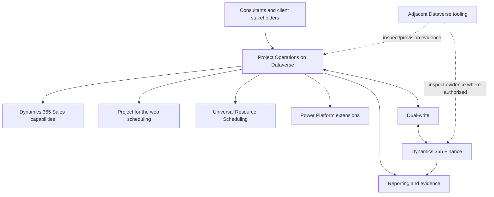

# System Map

Project Operations work normally spans sales, project planning, resource management, delivery transactions, billing, accounting, security, ALM and operational support. The exact boundary depends on the selected deployment model.

## Working boundary

| Layer | Typical concern | Source of truth to confirm |
| --- | --- | --- |
| Dataverse Project Operations | Sales, contracts, projects, resources, proforma and front-office user experience | Microsoft Project Operations documentation |
| Dynamics 365 Finance | Accounting, tax, exchange rates, financial dimensions, customer-facing invoicing and revenue recognition in integrated scenarios | Microsoft Project Operations and Finance documentation |
| Dual-write | Synchronisation, map versions, initial sync, recovery and reconciliation | Microsoft dual-write and Project Operations integration documentation |
| Power Platform | Solutions, plugins, flows, environment configuration and ALM | Power Platform ALM and Dataverse documentation |
| Consulting toolkit | Discovery, audit, decisions, evidence, findings and templates | This knowledge base, engagement-specific evidence and reviewed client deliverables |

:::info[Primary Microsoft entry points]

Start with the [Project Operations documentation](https://learn.microsoft.com/en-us/dynamics365/project-operations/), [deployment type guidance](https://learn.microsoft.com/en-us/dynamics365/project-operations/environment/determine-deployment-type), [Project Operations updates](https://learn.microsoft.com/en-us/dynamics365/project-operations/whats-new/project-operations-updates) and [Power Platform ALM](https://learn.microsoft.com/en-us/power-platform/alm/).

:::

## Open checks

- Confirm whether the client uses Project Operations Core, Integrated with ERP, manufacturing-based scenarios, or a mixed legal-entity model.
- Confirm which Finance and Dataverse versions are live.
- Confirm whether dual-write is configured, which maps are installed and whether errors exist.
- Confirm whether project accounting activities are performed in Finance, Dataverse or both.
