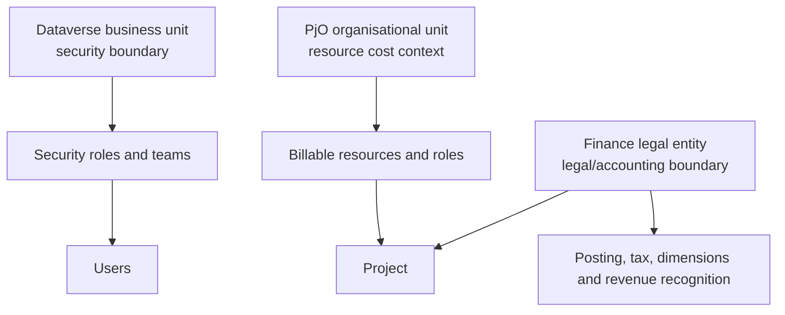

# Business Units, Organisational Units and Legal Entities

These concepts are often confused because their names overlap with ordinary business language. Treat them as separate modelling tools until evidence proves a deliberate alignment.

## Conceptual distinction

| Concept | Primary purpose | Common mistake |
| --- | --- | --- |
| Dataverse business unit | Security boundary used with users, teams, ownership and security roles. | Modelling every client company or PjO organisation as a business unit without checking access requirements. |
| Project Operations organisational unit | Groups billable resources with a cost structure, currency and cost price lists. | Treating it as the same thing as Dataverse security or Finance legal ownership. |
| Finance legal entity | Legal/accounting organisation associated with company ID/DataAreaId and financial reporting. | Assuming each legal entity requires a separate Dataverse business unit. |
| Finance operating unit | Internal organisation for operational control and reporting, such as department, cost centre or business unit. | Confusing Finance operating unit "business unit" with Dataverse business unit. |

:::info[Official definitions to check]

Microsoft describes Dataverse business units as a security modelling building block, Project Operations organisational units as groups/divisions that employ billable resources with cost rates, and Finance legal entities as organisations that can enter contracts and prepare performance statements.

:::

## Assessment questions

- Which Dataverse business units exist and why?
- Which users and teams are assigned to each business unit?
- Is modernized business unit security enabled?
- Which Project Operations organisational units exist, and which cost price lists and currencies do they use?
- Which Finance legal entities are in scope?
- Which legal entities are resource-owning, contracting, invoicing or posting companies?
- Where does the client use the phrase "business unit" generically, and what system concept does it map to?

:::warning[Do not design security from the org chart alone]

Dataverse business units are security boundaries. A client organisation chart may inform security, but it should not be copied into Dataverse unless it supports concrete access, ownership and administration requirements.

:::

## Primary Microsoft documentation

- [Security concepts in Microsoft Dataverse](https://learn.microsoft.com/en-us/power-platform/admin/wp-security-cds)
- [Security roles and privileges for Dataverse](https://learn.microsoft.com/en-us/power-platform/admin/security-roles-privileges)
- [Modernized business units security](https://learn.microsoft.com/en-us/power-platform/admin/modernized-business-units-security)
- [Organizational units overview](https://learn.microsoft.com/en-us/dynamics365/project-operations/sales/orgunits)
- [Organizations and organizational hierarchies overview](https://learn.microsoft.com/en-us/dynamics365/fin-ops-core/fin-ops/organization-administration/organizations-organizational-hierarchies)
- [Plan your organizational hierarchy](https://learn.microsoft.com/en-us/dynamics365/fin-ops-core/fin-ops/organization-administration/plan-organizational-hierarchy)
