# Data Flow and Lifecycle

This is a conceptual orientation map. It is not a physical data model and should not be used as evidence of exact table relationships.

```mermaid
flowchart LR
    LEAD[Lead / opportunity]
    QUOTE[Project quote]
    CONTRACT[Project contract]
    PROJECT[Project and schedule]
    RESOURCE[Resources and assignments]
    TIME[Time, expense and materials]
    ACTUAL[Actuals and corrections]
    PROFORMA[Proforma invoice]
    CUSTINV[Customer-facing invoice]
    LEDGER[Finance posting / ledger]

    LEAD --> QUOTE --> CONTRACT --> PROJECT
    PROJECT --> RESOURCE
    RESOURCE --> TIME
    TIME --> ACTUAL
    ACTUAL --> PROFORMA
    PROFORMA --> CUSTINV
    ACTUAL --> LEDGER
    CUSTINV --> LEDGER
```

## Lifecycle checks

| Stage | Evidence to collect |
| --- | --- |
| Sales and contract | Opportunity, quote, project contract, contract lines and billing method evidence. |
| Planning and resourcing | Project schedule, task ownership, project team, resource requirements and bookings. |
| Delivery transaction | Time, expense, material usage, approval and correction records. |
| Actuals | Actual creation, correction, transaction connections and reconciliation status. |
| Billing | Proforma review, invoice proposal and customer-facing invoice route. |
| Finance | Posting profiles, tax, exchange rate, financial dimensions, ledger/revenue recognition evidence. |

:::warning[Actuals are not ordinary working records]

Actuals and downstream financial records can carry billing, accounting and reconciliation consequences. Do not treat remediation as ordinary CRUD until the supported correction route is verified.

:::
