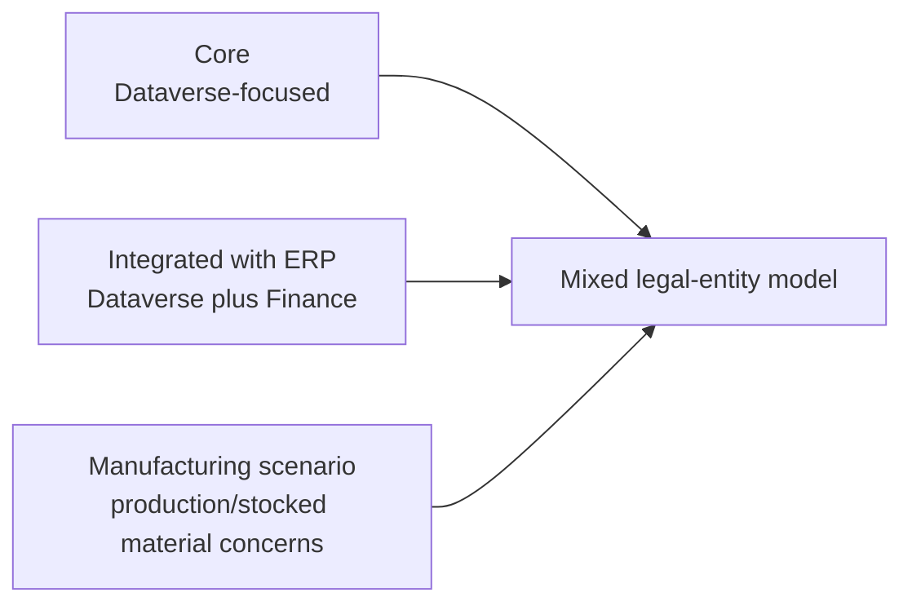

# Deployment Options

For implementation and assessment work, the deployment model is the first architectural classification. It should be recorded in the decision register and revisited when legal entities, integration responsibilities or accounting scope change.

## Consulting implications

| Concern | Core | Integrated with ERP | Manufacturing scenario |
| --- | --- | --- | --- |
| Main operational UI | Dataverse | Dataverse and Finance | Finance/manufacturing plus project capabilities |
| Accounting depth | Limited compared with Finance-backed scenarios | Finance-backed accounting and revenue recognition | Manufacturing and inventory-linked accounting concerns |
| Integration dependency | Lower | Dual-write is central | Confirm current architecture and legal-entity applicability |
| Evidence focus | Dataverse configuration and process outcomes | Dataverse, Finance, dual-write and reconciliation | Finance/manufacturing setup, inventory and project accounting evidence |

See also [Deployment Models](../../00-start-here/deployment-models.md).
