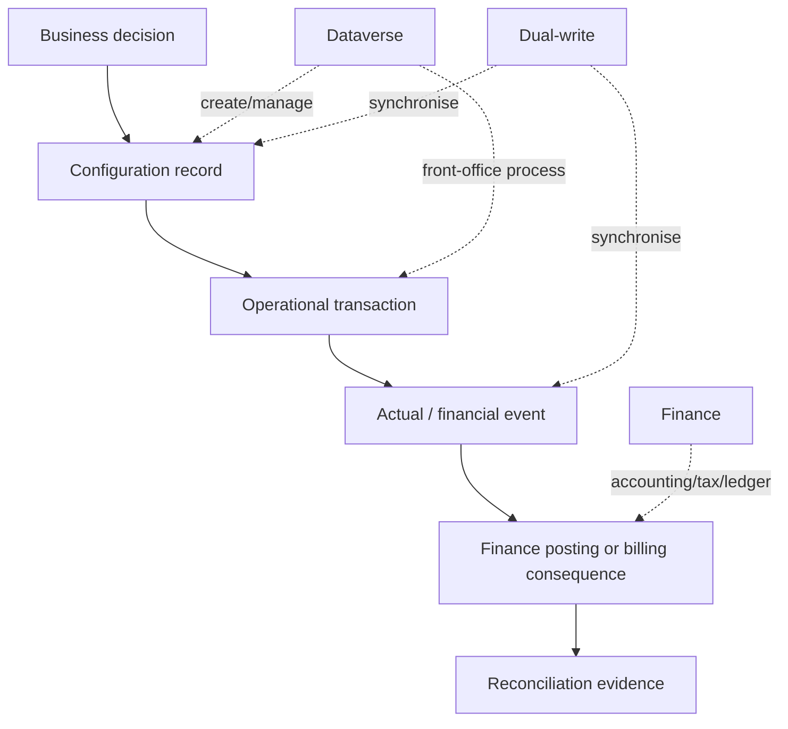

# Ownership Boundaries

Project Operations records can be owned operationally, financially and technically by different systems or teams. A useful architecture page should state who creates, updates, validates, synchronises, posts and reconciles each material record.

## Boundary checklist

- Which system is the creation point?
- Which system is allowed to enrich the record?
- Which changes are synchronised and which are not?
- Which record state triggers financial consequences?
- Which recovery path is supported if synchronisation fails?
- Which team owns operational correction versus financial correction?

:::warning[Do not infer ownership from table visibility]

Seeing a record in Dataverse or Finance does not automatically mean it is safe to create, update or delete there. Confirm the documented ownership and supported interface before remediation.

:::

## Primary Microsoft documentation

- [Project Operations setup and configuration data integration](https://learn.microsoft.com/en-us/dynamics365/project-operations/environment/resource-dual-write-setup-integration)
- [Project Operations dual-write integration overview](https://learn.microsoft.com/en-us/dynamics365/project-operations/environment/resource-dual-write-overview)
