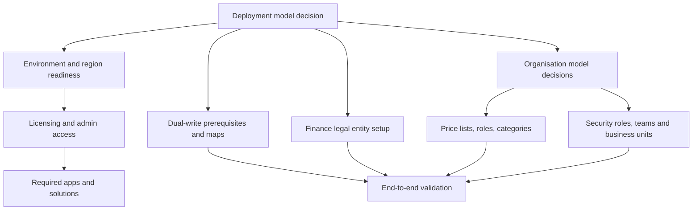

# Dependency Map

Use this as a planning aid, not as an installation runbook. Confirm the exact deployment steps against Microsoft documentation for the selected model.

## Dependency rules

| Dependency | Applies to | Evidence |
| --- | --- | --- |
| Deployment model selected | All | Decision record and Microsoft deployment guidance. |
| Environment supports chosen apps | All | Environment details, installed apps, region and licensing evidence. |
| Legal entities identified | Integrated ERP and manufacturing; sometimes Core for design context | Finance company evidence and client operating model. |
| Organisational units and price lists defined | Core and Integrated ERP | PjO settings, cost price lists and currency evidence. |
| Dual-write prerequisites complete | Integrated ERP | Installed solutions, refreshed entities, installed maps and map health. |
| Security model agreed | All | Business units, roles, teams, users and access test evidence. |

:::warning[Configuration order matters]

Configuration records often depend on deployment type, legal entity, currency, price list, security and integration prerequisites. Capture failed dependency assumptions as findings, not just setup errors.

:::

## Primary Microsoft documentation

- [Determine your deployment type](https://learn.microsoft.com/en-us/dynamics365/project-operations/environment/determine-deployment-type)
- [Deploy Project Operations Core](https://learn.microsoft.com/en-us/dynamics365/project-operations/environment/lite-deployment)
- [Manually deploy the Project Operations Dataverse app with dual-write support](https://learn.microsoft.com/en-us/dynamics365/project-operations/environment/resource-manual-deploy-dataverse-dualwrite)
- [Install Project Operations dual-write map versions](https://learn.microsoft.com/en-us/dynamics365/project-operations/environment/resource-dual-write-maps)
