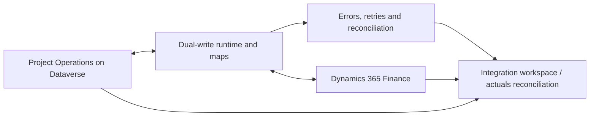

# Dual-write Architecture

In Integrated with ERP scenarios, Project Operations uses dual-write to synchronise data between Dataverse and Dynamics 365 Finance. Dual-write is not just plumbing: it affects ownership, recovery, audit evidence and reconciliation.

## Conceptual flow

## What to verify

| Area | Evidence |
| --- | --- |
| Prerequisites | Required Dataverse apps, Finance solutions, entity refresh and map installation evidence. |
| Map versions | Installed Project Operations maps, versions, customisations and disabled maps. |
| Ownership | Which records are created in Dataverse, enriched in Finance or synchronised both ways. |
| Errors | Dual-write errors, failed initial sync, stuck records and business validation failures. |
| Reconciliation | Integration workspace evidence, actuals reconciliation and trial balance implications. |
| Recovery | Supported retry, resynchronisation, correction or compensation route. |

:::warning[Map health is engagement evidence]

Do not treat map errors as operational noise during an assessment. They may explain missing actuals, unmatched transaction connections, invoice issues or financial reconciliation differences.

:::

## Primary Microsoft documentation

- [Project Operations dual-write integration overview](https://learn.microsoft.com/en-us/dynamics365/project-operations/environment/resource-dual-write-overview)
- [Manually deploy the Project Operations Dataverse app with dual-write support](https://learn.microsoft.com/en-us/dynamics365/project-operations/environment/resource-manual-deploy-dataverse-dualwrite)
- [Project Operations setup and configuration data integration](https://learn.microsoft.com/en-us/dynamics365/project-operations/environment/resource-dual-write-setup-integration)
- [Install Project Operations dual-write map versions](https://learn.microsoft.com/en-us/dynamics365/project-operations/environment/resource-dual-write-maps)
- [Project Operations integration workspace](https://learn.microsoft.com/en-us/dynamics365/project-operations/troubleshooting/project-operations-integration/project-integration-workspace)
- [Use actuals synchronization and reconciliation](https://learn.microsoft.com/en-us/dynamics365/project-operations/troubleshooting/project-operations-integration/manage-actuals-reconciliation)
