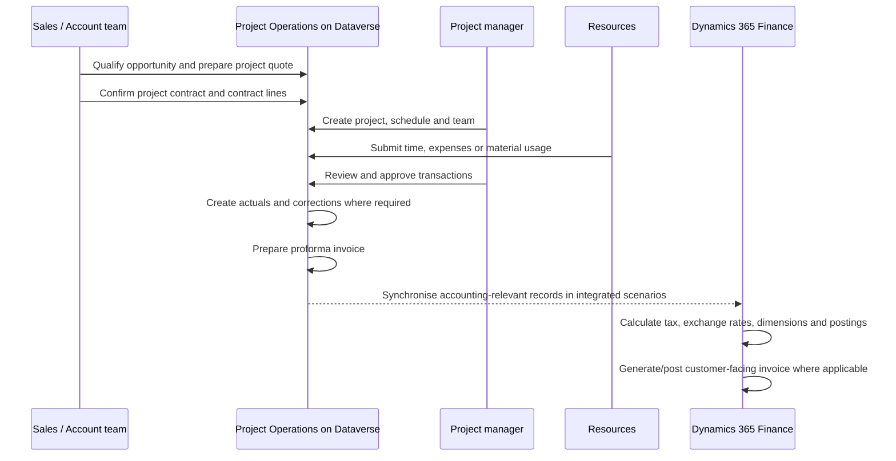

# Sales to Financial Posting

This page gives a first-pass conceptual view of the project lifecycle. The exact record ownership and posting behaviour must be verified for the deployment model.

## Conceptual process

## Control points

| Stage | What to verify |
| --- | --- |
| Sales | Opportunity-to-quote-to-contract lifecycle, billing method and contract line design. |
| Planning | Project schedule ownership, task management approach and supported scheduling interfaces. |
| Resourcing | Resource roles, skills, requirements, bookings and assignments. |
| Delivery | Time/expense/material approvals, correction path and cut-off controls. |
| Actuals | Creation timing, transaction connection, correction/reversal route and reconciliation status. |
| Billing | Proforma review, invoice proposal, customer invoice and posting status. |
| Finance | Tax, dimensions, WIP, revenue recognition, ledger posting and reconciliation. |

:::warning[Deployment-sensitive billing]

Core and Integrated with ERP scenarios do not have the same downstream billing and accounting responsibilities. Confirm whether the client expects proforma-only review, Finance customer-facing invoicing, revenue recognition or ledger posting.

:::

## Related topics

- [Deployment Models](../../00-start-here/deployment-models.md)
- [Ownership Boundaries](../architecture/ownership-boundaries.md)
- [Dual-write Architecture](../integration/dual-write-architecture.md)
