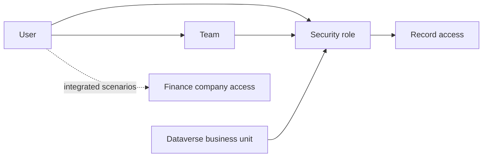

# Security

Project Operations security work must cover Dataverse security, app roles, teams, record ownership, Finance company access and operational segregation where applicable.

## First-pass checklist

- Identify Dataverse business units, users, teams and assigned security roles.
- Confirm whether modernized business unit security is enabled.
- Test access using representative personas, not only administrator accounts.
- For integrated scenarios, confirm Finance roles and legal-entity/company access.
- Check segregation risks around project setup, approval, billing, correction and posting.

## Primary Microsoft documentation

- [Security concepts in Microsoft Dataverse](https://learn.microsoft.com/en-us/power-platform/admin/wp-security-cds)
- [Security roles and privileges for Dataverse](https://learn.microsoft.com/en-us/power-platform/admin/security-roles-privileges)
- [Assign security roles](https://learn.microsoft.com/en-us/power-platform/admin/assign-security-roles)
