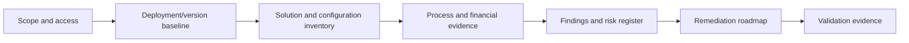

# Existing Implementation

Use this playbook when assessing or remediating an inherited Project Operations environment.

## Assessment workstreams

| Workstream | Evidence focus |
| --- | --- |
| Deployment baseline | Deployment model, versions, installed apps, legal entities and enabled features. |
| Customisation inventory | Solutions, plugins, flows, JavaScript, integrations and unsupported changes. |
| Configuration and security | Organisation model, business units, roles, teams, price lists and dependencies. |
| Integration and financial audit | Dual-write maps, errors, actuals, invoice proposals, postings and reconciliation. |
| Process regression | Representative end-to-end tests from sales through posting or proforma as applicable. |
| Findings | Evidence-backed risks, impact, recommended action, owner and acceptance test. |

:::warning[Findings need evidence]

Each finding should include observed condition, evidence source, impact, confidence, affected legal entities/systems, recommendation and acceptance test.

:::

See also [Acquisition and legal-entity onboarding](./acquisition-and-legal-entity-onboarding/index.md).
