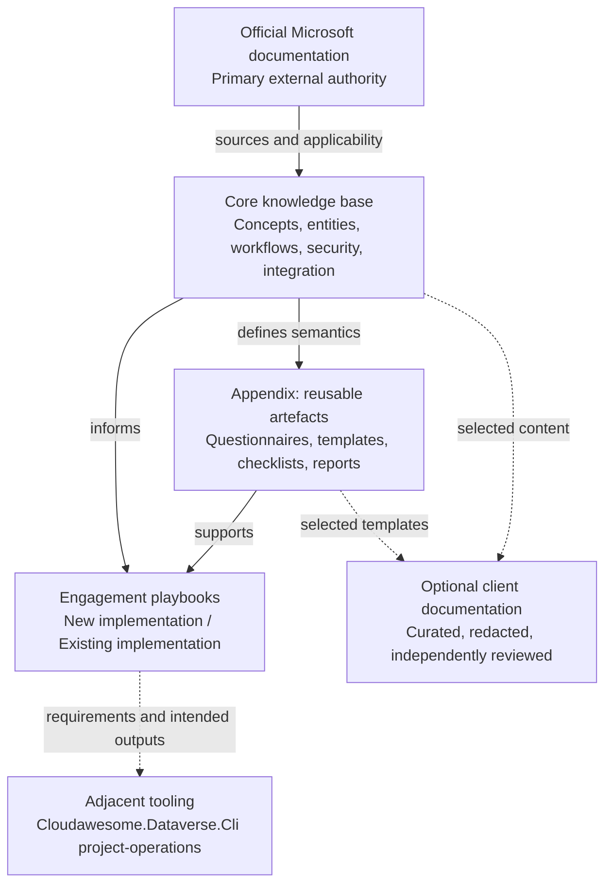
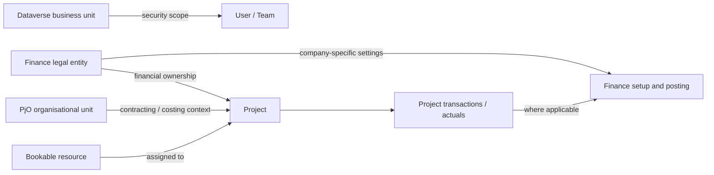
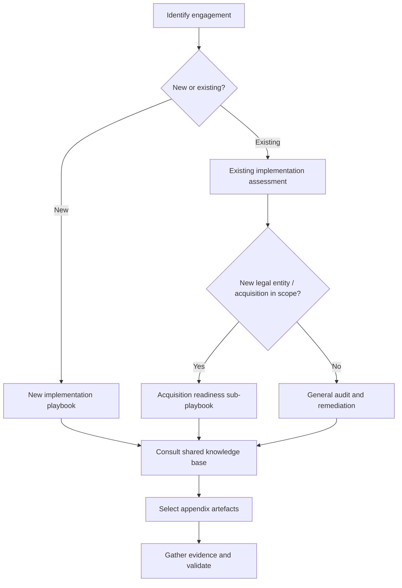
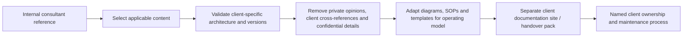

# Project Operations Knowledge Base — Project Charter and Content Blueprint

> **Document status:** Initial planning baseline (v0.1)  
> **Prepared:** 11 October 2026  
> **Primary audience:** The owner of this internal consultant knowledge base, and coding/documentation assistants (including Codex) helping maintain it.  
> **Purpose:** A stable brief to guide creation of the first Docusaurus release and subsequent iteration.  
> **Scope note:** This is a project specification and editorial blueprint, **not yet the completed Project Operations reference**. Product details must be checked against current Microsoft documentation as the individual pages are authored.

:::info[Internal-first documentation]

This site is a **personal technical reference and repeatable consulting toolkit**. It is not intended to be delivered wholesale to clients. Selected, reviewed material and templates may later be transformed into **separate client-owned documentation sites or deliverables**. Internal opinions, diagnostics, sensitive findings and personal notes must never be assumed suitable for client publication.

:::

## 1. Vision

Create a substantial, continuously maintained, Docusaurus-based knowledge base for **Microsoft Dynamics 365 Project Operations (PjO)** and the surrounding Dataverse, Dynamics 365 Finance, Power Platform and integration architecture. It should support rapid professional reacclimatisation after extended periods away from PjO and provide reusable approaches across **greenfield, brownfield, independent/Core, ERP-integrated, manufacturing and mixed-scenario** engagements.

The system should help answer four different kinds of questions:

1. **What is it?** — Concise conceptual explanations, relevant entities, features, standard behaviours and official sources.
2. **How does it work?** — End-to-end processes, data ownership, state transitions, integrations, security and deployment dependencies.
3. **How should it be implemented or assessed?** — Decision frameworks, patterns, checklists, evidence, tests and engagement playbooks.
4. **What can be reused?** — Blank pro formas, questionnaires, assessment artefacts, reporting templates and validated configuration/inspection expectations.

The first version will be the largest knowledge-capture exercise. The site then evolves incrementally as new engagements, releases, findings and tools improve the material.

### Non-goals

- A client-facing portal by default.
- A wholesale reproduction of Microsoft Learn content.
- An undocumented assertion that every practice applies to every deployment model.
- A customer-specific implementation guide masquerading as a universal reference.
- Low-level implementation documentation, command syntax or code for the separate provisioning/inspection CLI.
- An automated assessment that claims certainty without sufficient evidence.

## 2. Architecture of the knowledge base

**Separate content according to its purpose, not just technical subject.** Conceptual knowledge should remain independent of the type of client engagement. Playbooks apply that knowledge to delivery situations. Reusable artefacts are a third, clearly distinct layer.



### Distinguish the following explicitly

- **Vendor-documented behaviour:** What Microsoft says is supported, with official URL, applicability and verification date.
- **Consultant interpretation / preferred practice:** Analysis, trade-offs, recommendations and assumptions, clearly marked as such.
- **Environment-specific evidence:** Observed customer behaviour, metadata, configuration or transactions; lives in an engagement workspace, not in the general knowledge base unless sanitised into a reusable pattern.
- **Questions and hypotheses:** Items awaiting empirical or source confirmation must remain clearly flagged.

## 3. Proposed information architecture

N.B. This documentation is a subset of the whole CloudAwesome docs site. Everything described here, must sit underneather the docs/project-ops directory.

This is the starting structure, not a restriction on future organisation. Folder naming can be refined, but the **knowledge / playbook / appendix separation must remain**.

```text
docs/project-ops
├── project-operations-knowledge-base-charter.md    # This document, temporarily, will likely be deleted once the content is up and running
├── 00-start-here/
│   ├── index.md                     # How to use and maintain this sub-site
│   ├── fast-refresh.md              # One-day PjO reacclimatisation route
│   ├── system-map.md                # Overall system boundaries and glossary
│   ├── deployment-models.md
│   ├── terminology.md
│   └── release-watch.md             # Changes, version notes, review queue
│
├── 01-knowledge-base/
│   ├── architecture/
│   │   ├── index.md
│   │   ├── deployment-options.md
│   │   ├── ownership-boundaries.md
│   │   ├── business-units-org-units-legal-entities.md
│   │   ├── data-flow-and-lifecycle.md
│   │   └── extensibility-boundaries.md
│   ├── data-model/
│   │   ├── index.md
│   │   ├── entities-catalogue.md
│   │   ├── organisations-and-companies.md
│   │   ├── resources-roles-and-skills.md
│   │   ├── pricing-costing-and-categories.md
│   │   ├── sales-contracts-and-billing.md
│   │   ├── projects-planning-and-scheduling.md
│   │   ├── estimates-budgets-and-forecasts.md
│   │   └── time-expenses-actuals-and-invoices.md
│   ├── configuration/
│   │   ├── index.md
│   │   ├── dependency-map.md
│   │   ├── shared-dataverse.md
│   │   ├── core-specific.md
│   │   ├── erp-integrated.md
│   │   ├── finance-per-legal-entity.md
│   │   └── manufacturing-specific.md
│   ├── processes/
│   │   ├── index.md
│   │   ├── lead-opportunity-quote-contract.md
│   │   ├── project-planning-resourcing.md
│   │   ├── time-and-expense.md
│   │   ├── actuals-and-corrections.md
│   │   ├── proforma-to-invoice.md
│   │   ├── project-to-ledger.md
│   │   ├── intercompany.md
│   │   └── month-end-reconciliation.md
│   ├── security/
│   │   ├── index.md
│   │   ├── business-units-and-ownership.md
│   │   ├── roles-teams-sharing.md
│   │   ├── finance-legal-entity-security.md
│   │   └── segregation-and-audit.md
│   ├── integration/
│   │   ├── index.md
│   │   ├── dual-write-architecture.md
│   │   ├── maps-dependencies-initial-sync.md
│   │   ├── error-recovery-reconciliation.md
│   │   └── custom-integrations.md
│   ├── engineering/
│   │   ├── index.md
│   │   ├── alm-and-release-management.md
│   │   ├── solutions-vs-configuration-data.md
│   │   ├── scheduling-apis-and-customisations.md
│   │   ├── monitoring-and-operations.md
│   │   └── performance-and-limits.md
│   └── troubleshooting/
│       ├── index.md
│       ├── diagnostics-catalogue.md
│       ├── known-issues.md
│       ├── anti-patterns.md
│       └── support-playbooks.md
│
├── 02-engagement-playbooks/
│   ├── index.md
│   ├── new-implementation/
│   │   ├── index.md
│   │   ├── discovery-and-decision-capture.md
│   │   ├── deployment-model-selection.md
│   │   ├── target-architecture.md
│   │   ├── baseline-configuration.md
│   │   ├── integration-and-alm.md
│   │   └── validation-and-handover.md
│   ├── existing-implementation/
│   │   ├── index.md
│   │   ├── assessment-scope-and-access.md
│   │   ├── architecture-and-solution-inventory.md
│   │   ├── configuration-and-security-audit.md
│   │   ├── integration-and-financial-audit.md
│   │   ├── process-regression-and-reconciliation.md
│   │   ├── findings-and-remediation-roadmap.md
│   │   ├── remediation-validation.md
│   │   └── acquisition-and-legal-entity-onboarding/
│   │       ├── index.md
│   │       ├── operating-model-decisions.md
│   │       ├── readiness-and-dependencies.md
│   │       ├── repeatable-onboarding.md
│   │       └── acceptance-tests.md
│   └── transversal/
│       ├── stakeholder-workshops.md
│       ├── risk-and-issue-management.md
│       ├── evidence-standards.md
│       └── client-handover.md
│
├── 03-appendices/
│   ├── index.md
│   ├── templates/
│   │   ├── questionnaires/
│   │   ├── configuration-workbooks/
│   │   ├── decision-records/
│   │   ├── architecture-diagrams/
│   │   ├── audit-and-findings/
│   │   ├── validation-and-tests/
│   │   ├── deployment-and-handover/
│   │   └── communication-and-reporting/
│   ├── checklists/
│   ├── reference-matrices/
│   ├── example-deliverables/        # Synthetic/sanitised only
│   ├── glossary-and-acronyms.md
│   └── official-resources.md
│
└── 04-tooling-interface/
    ├── index.md                     # Purpose and boundary only
    ├── desired-provisioning-outputs.md
    ├── desired-inspection-outputs.md
    └── shared-rule-and-evidence-concepts.md
```

:::tip[Keep engagement logic separate]

The same reference page about organisational units should serve a new implementation, a brownfield assessment and an acquisition. Each playbook **links to** that page and adds engagement-specific questions, activities, evidence requirements and acceptance criteria. Avoid duplicating the technical explanation in every playbook.

:::

## 4. Functional coverage map

Initial coverage should address at least the following areas. **The often-mentioned ~16 PjO entities are a prompt for a configuration/master-data inventory, not a definitive count of product tables.** Record exact Dataverse logical names, Finance entities and applicability only when verified.

| Domain                  | Entities, configurations or functions to cover                                                       |
|-------------------------|------------------------------------------------------------------------------------------------------|
| Organisation            | Legal entities, Dataverse business units, organisational units, contracting and resourcing companies |
| Sales                   | Accounts, opportunities, quotes, quote lines, project contracts, contract lines                      |
| Resources               | Bookable resources, teams, roles, skills/characteristics, requirements, bookings, assignments        |
| Projects                | Projects, tasks, dependencies, schedules, project teams, project classifications                     |
| Pricing                 | Sales/cost price lists, labour rates, categories, currencies, cost and billing approaches            |
| Financial planning      | Estimates, budgets, forecasts and relevant Finance accounting parameters                             |
| Delivery transactions   | Time, expenses, materials, approvals, corrections and adjustments                                    |
| Actuals and integration | Actuals, transaction connections, integration journals and sync/reconciliation                       |
| Billing                 | Billing methods, proforma, invoice proposals, invoice posting and correction                         |
| Accounting              | WIP, revenue recognition, ledger posting, dimensions, tax, intercompany                              |
| Platform                | Solutions, plugins, Power Automate, environments, identities and extensibility                       |
| Dual-write              | Map versions, prerequisites, initial synchronisation, errors, customisations and recovery            |
| Security                | Dataverse privileges/ownership/teams and Finance security/company access                             |
| ALM                     | Provisioning, deployment order, config migrations, test automation, operational monitoring           |

Each entity reference should aim to include **business meaning; product/version applicability; Dataverse logical name or Finance equivalent; relationships; important fields; record lifecycle; configuration dependencies; ownership and security; system of record; dual-write map (if applicable); supported extension points; failure modes; validation/evidence methods; and deep links to official sources**.

## 5. Architectural distinctions to revisit frequently

1. **Deployment models:** Core, Integrated with ERP and manufacturing-based scenarios differ materially. Applicability must be labelled on every relevant page. Legal-entity-specific choices and mixed scenarios warrant coverage.
2. **Organisation versus security:** Dataverse business units, PjO organisational units, Finance legal entities and resource/company relationships must not be conflated.
3. **Dataverse versus Finance ownership:** Document which system creates, authorises, synchronises or posts each record and what happens on failure.
4. **Actuals versus financial postings:** Explain creation, correction, reversal, reconciliation and reporting consequences rather than treating these as ordinary CRUD records.
5. **Solutions versus operational data:** ALM, configuration migration and ongoing financial operations are separate lifecycles.
6. **Supported APIs:** Scheduling and other product-owned records may require dedicated supported interfaces; do not assume direct table writes are safe.
7. **Configuration applicability:** A prerequisite can depend on deployment type, feature, region, product version and legal entity.

Example relationship overview (illustrative conceptual diagram, **not** a literal relational schema):



## 6. Mandatory authoring conventions

### 6.1 Microsoft-first linking

- Link **heavily and directly** to relevant Microsoft Learn pages throughout, including entity and feature definitions, supported configuration, troubleshooting, constraints and product-version caveats.
- Write an original, concise summary that explains **what the feature means and why it matters**. Do not reproduce lengthy official documentation.
- Prefer deep links to precise Microsoft sections over a single generic homepage link.
- Record dates of verification and note where guidance conflicts, appears out of date, or is deployment-specific.
- Preserve the distinction between official behaviour and consultant advice.
- Every major substantive reference article should have a **Primary Microsoft documentation** section and inline links next to the claims they support.
- Where no adequate official page exists, mark that limitation and describe the proposed verification procedure; never invent a reference.

### 6.2 Extensive Mermaid diagrams

Use diagrams generously where they clarify relationships, boundaries, workflows, state transitions, sequencing or decisions. **Diagrams are working documentation, not decoration.**

Default expectations:

| Page type | Recommended diagram types |
| --- | --- |
| Architecture | `flowchart`, C4-inspired diagrams, system boundaries |
| Entity and data model | `erDiagram` with verified relationships, plus simplified conceptual `flowchart` |
| Business process | `flowchart` with swimlane-like subgraphs, `sequenceDiagram` |
| Record or transaction lifecycle | `stateDiagram-v2` |
| Integration | `sequenceDiagram`, failure/compensation flowchart |
| Configuration dependencies | Directed acyclic `flowchart` |
| Implementation/audit process | `flowchart`, `gantt` where helpful |
| Decision framework | Branching flowchart / decision tree |

Each diagram needs a descriptive heading and accompanying explanatory text. Clearly mark **conceptual versus exact data-level diagrams**; a conceptual association is not necessarily a physical foreign key. Keep diagrams readable, split oversized diagrams, and verify all labels/edges against sources. Treat the source Mermaid text as maintainable code and ensure it renders in Docusaurus.

Example process diagram:



### 6.3 Docusaurus admonitions

Use built-in `:::note`, `:::tip`, `:::info`, `:::warning` and `:::danger` callouts extensively **where there is a real reason to highlight a point**. Use descriptive titles rather than excessive generic notices.

Recommended meanings:

- `note`: Terminology, assumptions or nuance.
- `info`: Deployment/version applicability, official guidance, references and context.
- `tip`: Repeatable consultant technique or useful shortcut.
- `warning`: Configuration traps, common failure modes and conditions needing verification.
- `danger`: Risks of data loss, financial misstatement, unsupported changes or major security exposure.

Example:

```md
:::warning[Do not equate organisational units with business units]

The Project Operations organisational model and Dataverse security ownership model solve different problems. Assess both when defining multi-company access and resource sharing.

:::
```

Do not use admonitions as a substitute for precise prose, citations, validation steps or diagrams. Support important warnings with official links and practical tests.

### 6.4 Repeatable page anatomy

Suggested technical reference structure:

1. **At a glance** — 2–4 paragraph independent explanation.
2. **Applicability** — deployment, systems and version caveats.
3. **Conceptual model** — Mermaid diagram plus narrative.
4. **Principal entities and configuration** — tables with meaningful definitions.
5. **Lifecycle / process** — Mermaid workflow, sequence or state diagram.
6. **Implementation considerations** — supported options, decisions and dependencies.
7. **Security and integration** — where applicable.
8. **Common pitfalls and diagnostics** — actionable evidence or checks.
9. **Validation** — steps, expected results and limitations.
10. **Related topics and primary Microsoft sources** — direct links.
11. **Maintenance metadata** — last verified, scope and open questions.

Not every short glossary entry requires every heading, but foundational pages should be comprehensive. Use cross-links to avoid duplicated explanations.

Example content front matter (custom fields may need site tooling to make them searchable):

```yaml
title: Organisational units
sidebar_position: 3
tags: [organisation, security, configuration]
custom_edit_url: null
# Project-defined metadata; not an assertion that Docusaurus interprets all keys.
deployment: [core, integrated-erp]
source_reviewed: '2026-10-11'
verification_status: needs-technical-review
```

## 7. Engagement playbooks (separate from reference content)

### 7.1 New implementation

Provide a reusable discovery-to-handover route, including deployment selection, requirement/decision capture, organisational and financial design, security, integration selection, configuration dependencies, testing, support readiness and knowledge transfer.

**Expected outputs:** requirements and decision register, deployment model rationale, target architecture, security/organisation model, configuration input workbook, integration ownership matrix, ALM design, test coverage and acceptance/handover pack.

### 7.2 Existing implementation

Provide a defensible, read-only-first assessment process, usable for inherited projects at different levels of maturity, with optional remediation and subsequent improvements.

**Assessment workstreams:** deployment/version baseline; solution/customisation inventory; business and configuration data quality; security/organisation boundaries; dual-write/integrations; end-to-end operational processes; actuals, journals and financial reconciliation; ALM; supportability; and regression coverage.

**Expected outputs:** assessment scope, evidence manifest, environment inventory, validated findings, prioritised risk register, architectural options, remediation roadmap, validation plan and stakeholder report.

Each finding needs an ID, observed condition, evidence source, reproduction method where applicable, affected systems/legal entities, impact, confidence, applicability, recommended action, owner, acceptance test and status. Distinguish **pass**, **fail**, **not applicable** and **not tested**.

### 7.3 Acquisition and legal-entity onboarding (sub-playbook)

This remains under **existing implementation**, not a top-level type of knowledge. Analyse the new operating model, legal entities, organisational units, resourcing/intercompany, currencies, security, company-specific Finance setup, dual-write dependencies, data migration and process regression. Do not assume one new legal entity implies one new Dataverse business unit.

**Expected outputs:** acquisition readiness report, company onboarding decision pack, dependency plan, gap list, configuration evidence and acceptance criteria. Also document the differences between fresh legal-entity onboarding, merger/data consolidation and migration of an existing implementation/deployment model.

## 8. Appendix: reusable pro formas, templates and examples

This is a substantial first-class area, not a miscellaneous folder. For each template, specify **when to use it, intended audience, required fields, example completed version, evidence standards and expected output**. Source files may be Markdown, CSV, XLSX, DOCX or other suitable formats, while the Docusaurus page describes their purpose and usage.

Initial artefact inventory:

| ID    | Artefact                                                  | Used for                | Likely format   |
|-------|-----------------------------------------------------------|-------------------------|-----------------|
| T-001 | Stakeholder interview / discovery questionnaire           | New and existing        | Markdown / DOCX |
| T-002 | Deployment-model selection worksheet                      | New and existing        | Markdown / XLSX |
| T-003 | PjO business decision register                            | New and expansion       | XLSX / CSV      |
| T-004 | Required master/configuration data workbook               | New / entity onboarding | XLSX            |
| T-005 | Architecture decision record (ADR)                        | All engagements         | Markdown        |
| T-006 | Organisation/legal entity/business unit matrix            | All engagements         | XLSX            |
| T-007 | Role/persona/security access matrix                       | All engagements         | XLSX            |
| T-008 | System-of-record and integration mapping matrix           | ERP/integrated          | XLSX            |
| T-009 | Environment and solution inventory                        | Existing                | XLSX / Markdown |
| T-010 | Assessment scope and access request                       | Existing                | Markdown / DOCX |
| T-011 | Audit evidence register                                   | Existing                | CSV / XLSX      |
| T-012 | Findings and risk register                                | Existing                | XLSX / Markdown |
| T-013 | Brownfield assessment report                              | Existing                | Markdown / DOCX |
| T-014 | Remediation decision/prioritisation sheet                 | Existing                | XLSX            |
| T-015 | End-to-end test scenario and evidence record              | All engagements         | Markdown / XLSX |
| T-016 | Financial reconciliation worksheet                        | Integrated ERP          | XLSX            |
| T-017 | Dual-write map health and recovery checklist              | Integrated ERP          | Markdown / XLSX |
| T-018 | Change/deployment readiness checklist                     | All engagements         | Markdown        |
| T-019 | Legal-entity acquisition onboarding questionnaire         | Expansion               | Markdown / XLSX |
| T-020 | Acquisition readiness and acceptance report               | Expansion               | Markdown / DOCX |
| T-021 | Client-facing technical design / runbook skeleton         | Handover                | Markdown / DOCX |
| T-022 | Executive findings summary and communication template     | Reporting               | Markdown / DOCX |
| T-023 | Requirements-to-configuration-to-test traceability matrix | All engagements         | XLSX            |
| T-024 | Configuration/environment comparison report schema        | Existing / ALM          | JSON / Markdown |

Templates should avoid real client records or identifiable company data. Example deliverables must be synthetic or properly sanitised. Include clear instructions for creating customer-ready derivatives.

## 9. Separate tooling project: intended interface, not implementation detail

The related automation belongs in **[cloud-awesome/dataverse-customisation](https://github.com/cloud-awesome/dataverse-customisation)**, within **`Cloudawesome.Dataverse.Cli`**, under a **`project-operations`** command area. Do not add low-level CLI syntax, implementation plans, internal class structures or code to this knowledge base at this stage.

The documentation may, however, describe desired inputs, outputs, quality characteristics and validation rules:

- **Provisioning/initialisation:** Captured business decisions; deployment-specific reference/configuration data; validated dependency order; proposed change plan; idempotent/supported application of changes; human-readable completion and exception report.
- **Environment inspection:** Read-only discovery; configuration inventory; version/deployment identification; security and solution inventories; integration status; data-quality findings; cross-environment comparisons; reconciliation candidates; verifiable audit report.
- **Shared concepts:** A versioned configuration catalogue, required decision schema, applicability tags, validation rule IDs, expected outcomes, evidence records and exportable machine-readable outputs.
- **Safety:** Least privilege, read-only assessment by default, data minimisation/redaction, scoped retrieval, transparent incomplete coverage and no unsupported direct manipulation of PjO-owned transaction lifecycles.

Tooling design can evolve separately; documentation should not depend on implementation of any tooling to be useful.

## 10. Path from internal knowledge to client self-sufficiency

Client documentation is **derived selectively**, not produced by publishing the internal site in place.



Potential client-facing products: architecture overview, operating procedures, configuration register, security model, integration runbooks, support/recovery procedures, change management, regression tests, onboarding guides and administration/handover documentation. Internal diagnostics and personal working notes should be excluded unless intentionally revised for external use.

## 11. Initial-version backlog and definition of done

### Work package A — Build the Docusaurus foundation

- [ ] ~~Initialise site, version-control and navigation.~~ (Not a new site)
- [ ] Enable Mermaid and verify rendering in light/dark themes.
- [ ] Adopt admonition, linking, page metadata and Markdown style rules.
- [ ] Create sections, index pages and cross-link conventions.
- [ ] Add automated build and link checks, and a strategy for Mermaid validation.
- [ ] Publish this charter as an internal planning page.

### Work package B — High-value foundational reference

- [ ] Deployment models, system boundaries and glossary.
- [ ] Business units vs organisational units vs legal entities vs resources.
- [ ] Core data/entity catalogue with verified names and relationships.
- [ ] Pricing, costing, categories and configuration dependencies.
- [ ] End-to-end sales → planning → resourcing → time/expense → actuals → billing → financial posting diagrams.
- [ ] Dual-write architecture, maps, initial sync, troubleshooting and recovery.
- [ ] Security and ALM essentials.
- [ ] Official-source links and applicability annotations throughout.

### Work package C — Delivery playbooks

- [ ] New implementation discovery, design, configuration and validation.
- [ ] Existing implementation baseline, audit, evidence and reporting process.
- [ ] Acquisition/legal-entity sub-playbook and acceptance strategy.
- [ ] Reusable end-to-end test catalogue.

### Work package D — Appendix artefacts

- [ ] Prioritise and create core questionnaire, decision record, configuration workbook, audit/finding registers and assessment report.
- [ ] Create at least one synthetic completed example for each priority artefact.
- [ ] Cross-link templates from relevant knowledge pages and playbook tasks.

### Work package E — Maintainability and evolution

- [ ] Establish official source register, release watch and content review schedule.
- [ ] Track gaps, open questions and pages needing verification.
- [ ] Add contribution/AI-assistance instructions, including evidence and provenance requirements.
- [ ] Introduce a lightweight process for promoting sanitised engagement learnings into the shared knowledge base.

**Definition of done for a substantive reference page:** It answers the core question independently; explains applicability; includes deep Microsoft links; uses one or more appropriate diagrams where useful; highlights important risks with meaningful admonitions; explains real-world configuration or validation implications; links to relevant playbooks/templates; and contains no unsupported claims presented as fact.

**Definition of done for a playbook:** Scope, prerequisites, decision points, detailed activities, artefacts to populate, objective evidence requirements, acceptance criteria, dependencies, limitations and links to reference material.

**Definition of done for a template:** Clear purpose, fields, instructions, ownership, a reusable blank form and (where practical) a sanitised worked example.

## 12. Maintenance, versioning and quality controls

- Maintain page provenance: authoritative source URLs, source-check date, deployment applicability, caveats and unresolved uncertainties.
- Monitor Microsoft's Project Operations releases and revise affected content. Release notes should not automatically overwrite verified conclusions.
- Prioritise review after major Finance/Dataverse/PjO updates and changes in supported integration patterns.
- Keep architectural decisions and recommended practices distinct from Microsoft-mandated constraints.
- Maintain a changelog of substantive edits, especially altered guidance that affects financials, security or integrations.
- Test Docusaurus build, internal navigation, external links and diagrams during contributions.
- Prefer many well-scoped, linked pages over a few very long pages, while retaining coherent process overviews.
- Reassess the taxonomy after the first substantial content tranche, not after every new topic.

:::warning[Codex and other AI authoring assistants]

Do **not** fabricate Microsoft Learn links, Dataverse logical names, Finance entities, dual-write mappings, field semantics or product constraints. When uncertain, include an explicit **verification required** note and an action item. New pages should avoid invented version claims and distinguish product documentation from architectural judgment.

:::

## 13. Suggested immediate Codex work order

Use this document as the repository's project brief. The recommended implementation order is:

1. Establish the Docusaurus structure and conventions (including Mermaid, admonitions and automated build checks).
2. Create index pages that explain the knowledge/playbook/appendix separation.
3. Write the **deployment models**, **organisation concepts**, **full system map** and **fast refresher** pages with authoritative sources.
4. Build the entity/feature catalogue skeleton and dependency map, marking unverified details clearly.
5. Write the first complete integrated workflow article with Mermaid and inline Microsoft references.
6. Implement the initial **existing implementation audit** and **new implementation discovery** playbooks.
7. Create the priority appendix templates, then expand functional references and cross-links.
8. Review gaps and update this charter as the scope becomes concrete.

The goal is a **useful initial foundation, not an encyclopaedia before anything can be used**. Aim for comprehensive first-pass coverage of key domains, then improve depth and verification over subsequent engagements.

## 14. Initial authoritative sources and project links

Use these as **entry points**; individual content pages should link to much more specific Microsoft documentation:

- [Dynamics 365 Project Operations documentation](https://learn.microsoft.com/en-us/dynamics365/project-operations/)
- [Determine Project Operations deployment type](https://learn.microsoft.com/en-us/dynamics365/project-operations/environment/determine-deployment-type)
- [Project Operations Integrated with ERP deployment overview](https://learn.microsoft.com/en-us/dynamics365/project-operations/environment/project-operations-integrated-deployment-overview)
- [Deploy Project Operations Core](https://learn.microsoft.com/en-us/dynamics365/project-operations/environment/lite-deployment)
- [Project Operations updates](https://learn.microsoft.com/en-us/dynamics365/project-operations/whats-new/project-operations-updates)
- [Project to profit business processes](https://learn.microsoft.com/en-us/dynamics365/guidance/business-processes/project-to-profit-areas)
- [Power Platform ALM](https://learn.microsoft.com/en-us/power-platform/alm/)
- [Docusaurus Mermaid diagrams](https://www.docusaurus.io/docs/markdown-features/diagrams)
- [Docusaurus admonitions](https://www.docusaurus.io/docs/markdown-features/admonitions)
- [CloudAwesome Dataverse Customisation repository](https://github.com/cloud-awesome/dataverse-customisation)

---

**Guiding principle:** Build a personal, evidence-based **Project Operations knowledge and consulting toolkit**, with official Microsoft guidance as the primary factual authority; Mermaid and Docusaurus callouts as first-class explanatory tools; engagement playbooks distinct from domain knowledge; a substantial reusable appendix; optional export into curated client-owned documentation; and low-level CLI development intentionally outside this documentation scope.
